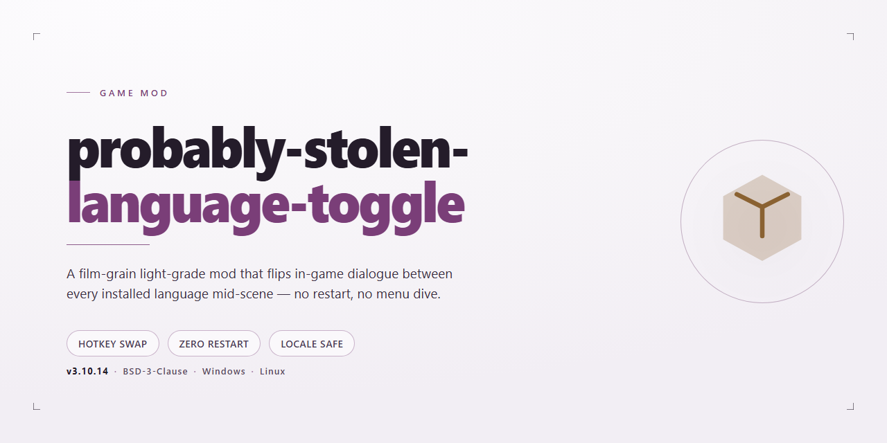

# 🎮 Probably Stolen Language Toggle for Windows

### 🔧 PowerShell Setup Button

   

---

This little quality-of-life mod for Probably Stolen Demo lets you tap Q to flip the whole demo between English and Simplified Chinese, so you can soak in the story one moment and brush up on your language skills the next. It ships as a portable Windows installer that wires itself into your own local copy of the game, keeping all extracted data right where it belongs—on your machine, never in the cloud. No translations are baked in and nothing gets phoned home; the mod simply toggles between the language sets the demo already carries. The installer handles the fiddly loader setup for you and leaves your saves and game files untouched, so you can experiment freely and pull it back out just as cleanly. Built with fellow tinkerers in mind, it's meant to be poked at, tweaked, and enjoyed.

## ✅ Requirements

- **OS:** Windows 10 / 11
- **Shell:** PowerShell 5.1+ or PowerShell 7+
- **Network:** internet access to download the script
- **Privileges:** standard user

## Features

- **Q 键一键切换** — 在游戏自带的英文与简体中文之间来回跳转，读剧情、学英语两不误，节奏不中断。
- **只动语言，不动存档** — 不碰你的进度文件，不写云端，不搞遥测；游戏自己的保存逻辑照常运转。
- **即装即用的 Windows 便携安装器** — 解压、双击、进游戏，剩下的交给它。自动识别游戏目录，找不到时让你手动指一下。
- **数据留在本机** — 安装时从你自己机器上的游戏里提取英中对照，生成专属语言表，全程离线，不向上传任何东西。
- **可逆操作，来去自由** — 提供启用、停用、卸载脚本，装得干净，卸得也干净；卸载前会核对文件归属，别人改过的文件不会被误删或覆盖。
- **输入框不抢戏** — 光标在输入框里时，Q 老老实实当字母用，不会误触切换。
- **字体随语言走** — 切换时同步更新游戏语言状态与对应字体，普通文字即时刷新，界面不别扭。
- **改键未至，Q 先顶着** — 目前 Q 是固定键位，简单直接；与其他占用 Q 的 MOD 可能打架，介意的话先留意一下。

## Installation

Getting the toggle into your game is refreshingly painless — the installer handles the heavy lifting so you can get back to flipping between languages with a single tap of Q.

First, grab the portable Windows installer package from wherever you picked up this mod, and unzip it into a folder you plan to keep around. Give that folder a home you won't mind visiting again, because the mod's runtime lives there and expects to stay put. Close the game before you begin — a clean slate saves headaches.

Once unzipped, run the installer executable and let it do its thing. It'll sniff out your Probably Stolen Demo installation on its own; if it can't find the game, it'll politely ask you to point it at the folder containing the game's executable. No registry spelunking, no manual file shuffling required.

After the installer finishes, launch the demo the way you normally would, wait a few seconds at the menu for everything to settle, and then press **Q**. That's it — English and Chinese swap on demand. Your game data never leaves your machine, and the whole thing stays portable.

A couple of friendly warnings from one modder to another: don't move or delete that unzipped folder after installation — the loader references it directly. If you ever need to relocate, uninstall first, then reinstall fresh in the new spot. And if the installer can't locate your game automatically, just browse to the folder holding the game's main executable and you're set.

## Compatibility

This mod is tuned for **Probably Stolen Demo** (Steam AppID `4349200`, build `25382790`, version `049-Rev5-L`) running on Unity `2021.3.45f2` / IL2CPP / x64 with BepInEx `6.0.0-be.788+5b766a3`. It was confirmed on Windows 11 x64; Windows 10 x64 is assumed to behave but wasn't exercised on real hardware.

If an update to the demo changes the build ID, the toggle will warn you it hasn't been tested and back off quietly, so fire it up on a fresh patch and expect a mismatch notice rather than a crash. The Chinese/English vocabulary comes entirely from the game's own language tables, so anything the demo never shipped in Chinese stays in English; nothing gets invented. If the game gets patched and something misbehaves, disable the mod first, note the build and version, and report it instead of relaunching over and over.

This is a solo-target mod. Other mods that grab the Q key, other IL2CPP titles, or the eventual full release aren't validated and may collide with the fixed bind — there's no rebind screen yet, so keep Q clear for the toggle. Toggle off and uninstall scripts are included so you can bail out cleanly before trying anything new on the same install.

## Credits & License

This little toggle exists because one player wanted to read the demo's story twice — once in English, once in Chinese — without restarting the whole show. It's a Community mod, built in the spirit of "poke the demo gently, don't break the shop." The project's own source and scripts live under the MIT license, so if you want to remix, fork, or teach your own mod to say Q too, go right ahead — just keep it friendly.

The mod is unofficial, unaffiliated, and uninvited by the developers and publishers of the game it dances with. All game content, names, and marks belong to their original owners. The installer never repackages, redistributes, or bakes in the game's language tables, art, or assemblies — it reads the copy you already own, builds a pair table on your machine, and keeps it there. Please don't upload that generated table to issue trackers or ask others to download it; it's a local dialect, not a souvenir.

The installation toolkit leans on a handful of well-known open-source helpers — the BepInEx loader framework, UnityPy for reading Unity assets, and the Python and uv toolchain for the installer's setup side. They arrive from their own official sources and are not bundled in this project's package, so you're getting them fresh from the makers. License notices for those pieces sit in the third-party notices document in this repository.

Credit also goes to the modding community whose publishing and conduct conventions shaped how this project behaves: no redistributing game internals, no cut corners on user data, and clear instructions for undoing everything. And a tip of the hat to the codex-assisted workflow that helped assemble the first working build, and to the players who tested the Q key in the wild and reported back which windows needed closing and reopening.

If you build on this mod, keep it local, keep it respectful, and leave the shop's inventory where you found it.